# The kernel development flow, end to end

Two loops, three layers. The **run loop** belongs to pi-goal (deterministic: a shell command in, a
gate verdict out). The **build loop** belongs to the human + main agent (tickets, code). Subagents
live only in the build loop and in one advisory seat of the run loop; they are never a gate input.

## Who owns what

| Layer | Owns | Never owns |
|---|---|---|
| **human** | the problem (`description.md`, shapes, tolerance, target), the freeze confirmation, contract changes, irreversible environment actions | the candidate loop |
| **main agent** | plan (milestone decisions), contract authoring, delegation, artifact review, escalation | measuring, gating (those are commands) |
| **subagent** | one decision implemented, one negative control authored, one diagnosis produced | the gate, the contract, the ledger |
| **pi-goal** | phase machine, contract hash, gate, journal, revert, reviewer for a diff | kernel knowledge, planning |
| **pi-kernel-expert** | kernel artifacts: draft/plan, milestone, contract shape, reading block, profile evidence, candidate ledger, refusals | the loop, the phase machine |
| **GPU (h200-7)** | the measurement itself | — |

## The flow

```mermaid
flowchart TD
  H0["human: task definition<br/>description.md · shapes.json · task.toml"] --> INIT

  subgraph FRAME["framing · no frozen contract"]
    INIT["kernel_init<br/>docs/draft.md + docs/plan.md"] --> BASE0["measure the current implementation<br/>(reading block + clocks + util)"]
    BASE0 --> DRAFT["fill draft: baseline · risks ·<br/>ranked directions · exact commands"]
    DRAFT --> DIRECT["frame_goal: ≥2 orthogonal directions<br/>probe_goal each with a cheap proxy"]
  end

  DIRECT --> GATE0{"converging:<br/>every direction kept or killed<br/>with an evidence pointer?"}
  GATE0 -- no --> DIRECT
  GATE0 -- yes --> CONTRACT

  subgraph FREEZE["freeze"]
    CONTRACT["kernel_contract<br/>cells × groups · tolerance · basis ·<br/>referenceCommand · harnessGlobs"] --> SCRIPTS["kernel.contract.json<br/>goal.sh · goal.checks.sh · kernel-freeze.json"]
    SCRIPTS --> H1{"human confirmation<br/>(freeze_criteria)"}
  end

  H1 -- "amend" --> CONTRACT
  H1 -- "approve" --> BL

  subgraph SEALED["sealed · the run loop"]
    BL["run_goal: baseline<br/>archived by (op, arch, basis, workloads, contract sha)"] --> CAND
    CAND["main: pick next decision<br/>(milestone frontier or direction)"] --> DEL
    DEL["delegate implementer subagent<br/>one decision · own worktree · kernel file only"] --> CHG["diff + the command it ran"]
    CHG --> RG["run_goal<br/>checks: cells × groups"]
    RG --> CK{"correctness<br/>all groups?"}
    CK -- no --> REJ["revert + reason<br/>→ dead-end table (bundle semantics)"]
    CK -- yes --> MET{"gate<br/>metric ≥ baseline+noise · guard · scope · protected paths"}
    MET -- fail --> REJ
    MET -- pass --> PROF["kernel_profile<br/>(only if a bottleneck is claimed)"]
    PROF --> KC{"kernel_candidate<br/>basis? host-bound? harness diff?<br/>fresh? precision?"}
    KC -- refuse --> REJ
    KC -- keep --> KEEP["commit with Gate:/Criteria: trailers<br/>+ ledger row + benchmark.csv"]
  end

  REJ --> PLATEAU
  KEEP --> PLATEAU
  PLATEAU{"plateau?<br/>N candidates, no new best > noise"} -- no --> CAND
  PLATEAU -- yes --> DIAG

  subgraph REVIEW["advisory · never a gate input"]
    DIAG["reviewer subagent<br/>fresh context · readonly · other model ·<br/>payload only (diff, ledger, readings)"] --> DX["returns: which decision is missing/broken ·<br/>cheapest discriminating measurement · what to abandon"]
    DX --> PATCH["plan patch via kernel_milestone<br/>(unknown changed_entries → refused)"]
  end

  PATCH --> CAND
  KEEP --> STOP{"stop?<br/>target met + fresh evidence · budget ·<br/>infeasible arithmetic"}
  STOP -- no --> CAND
  STOP -- yes --> PROMOTE["promote: this kernel becomes<br/>the next generation's reference"]
  PROMOTE --> H0
```

## Where a human is actually needed

Three seats, and only three. Each is a *phase*, not a mid-loop dialog:

| Seat | When | Why it cannot move | Mechanism |
|---|---|---|---|
| **Freeze** | before the first baseline | tolerance, matrix, metric direction, target GPU all invalidate prior evidence | `freeze_criteria` already requires one confirmation |
| **Contract change** | mid-run, rarely | the gate is the contract; changing it mid-run is a different experiment | stop + written question + `/goal allow-benchmark`-style pre-authorization |
| **Environment** | before/around a run | toolchain install, clock lock, which card, sudo | Ask First in the ticket, not in the loop |

**No blocking ask inside the candidate loop.** A modal dialog in an unattended or `/loop` run is a
deadlock; a candidate loop that stops to ask is a build loop wearing the wrong clothes. Escalation from
inside the loop is a refusal with a named rule, a written question, and an exit — which is what a
reader (human or agent) can act on hours later.

`ask_user_question` (a pi-dev-mode extension tool, not core pi) is therefore the right instrument for
the **build** lane and the **freeze** seat: one interaction, 2–4 options, a freeform row. It is the
wrong instrument for the run lane.

## Where subagents sit

| Role | Lane | Shape | Why a subagent and not the main agent |
|---|---|---|---|
| **implementer** | run loop, per candidate | one decision, own worktree, kernel file only, returns diff + command output | keeps the main context at planning altitude; one bounded artifact comes back |
| **negative-control author** | build loop, once | writes the deliberately broken bench (sleep 2 ms) and the expected refusal | the implementer must not author the test of its own refusal |
| **reviewer (diagnosis)** | run loop, at plateau | fresh context, readonly, other model, payload only | shares no theory with the agent it reviews — this is the whole point |
| **reviewer (gate)** | run loop, per keep, optional | pi-goal's `review_goal`: blind, isolated temp dir, JSON findings, blocks only on an executed failing repro | already exists in pi-goal; do not rebuild |
| **adjudicator** | ship gate | fresh context, other model, writes its own PASS/FAIL file | the claim survives an independent reader |

The engine for all of these is the host's `agent` tool (batch, worktree, readonly, per-task model).
Neither pi-goal nor pi-kernel-expert should ship a dispatch engine: pi-goal's gate must stay
deterministic, and a kernel package that vendors a subagent runtime has become a framework.
